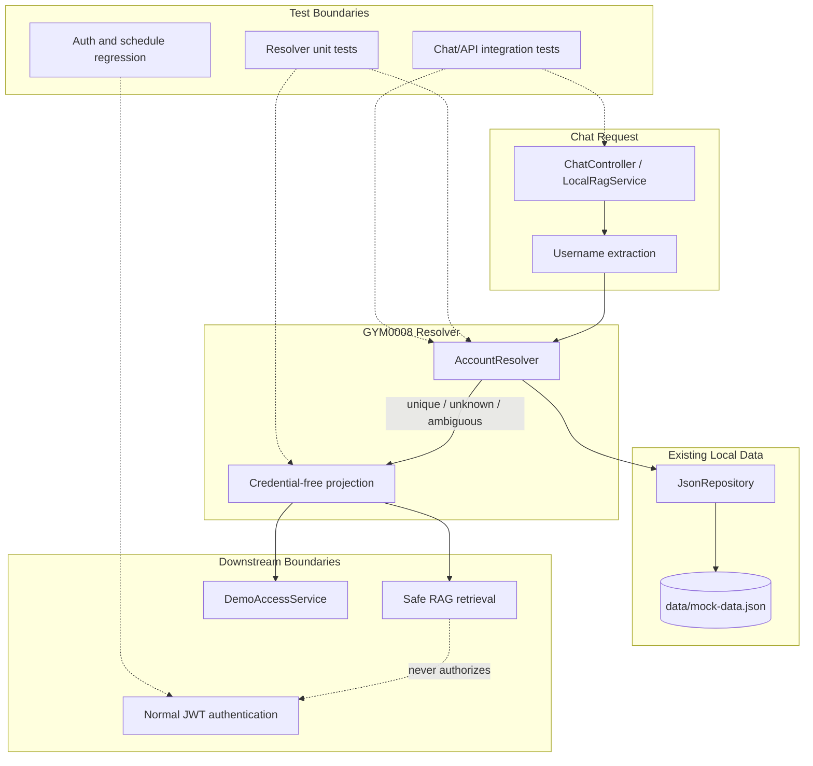

# Architectural Context

## Component Diagram

## Components Involved

- **ChatController / LocalRagService**: Receives the user message and invokes deterministic resolution before retrieval or model wording.
- **Username extraction**: Supplies a candidate username; it does not decide account identity.
- **AccountResolver**: Validates, normalizes, counts exact matches, and returns the discriminated result.
- **Credential-free projection**: Limits downstream data to `userId` and `username`.
- **JsonRepository**: Existing local source of account records and schedules.
- **Safe RAG / DemoAccessService**: Downstream consumers; neither may receive an ambiguous result as an authorization input.
- **Normal JWT authentication**: Unchanged and separate from this resolver.

## Integration Points

- **Repository read boundary**: Resolver reads local JSON-backed users through `JsonRepository`; no remote database or event bus.
- **Resolver result boundary**: `unique`, `unknown`, and `ambiguous` typed results are passed to orchestration.
- **RAG boundary**: Unique identity can scope safe schedule retrieval; unknown/ambiguous results produce no account context.
- **Demo access boundary**: Only GYM0009 may turn a unique projection into `demo_access`.
- **Normal auth boundary**: Resolver output never becomes a normal JWT and does not alter schedule guards.

## Test Boundaries

- **Unit tests**: Use real resolver logic with mocked/in-memory repository data; assert normalization, match count, and redaction.
- **Integration tests**: Exercise chat/controller -> resolver -> safe context and resolver -> demo-service handoff.
- **E2E tests**: No new resolver endpoint; downstream browser journeys cover the eventual chatbot access flow.
- **Regression tests**: Existing normal login and schedule ownership tests must remain green.

## Downstream Impacts

- GYM0009 depends on the exact unique-result shape before issuing temporary demo access.
- GYM0010 should consume this resolver rather than maintain a competing account-selection implementation.
- Duplicate or malformed data remains non-authorizing even if the AI provider is available.
- The local-only boundary and normal JWT behavior remain unchanged.
