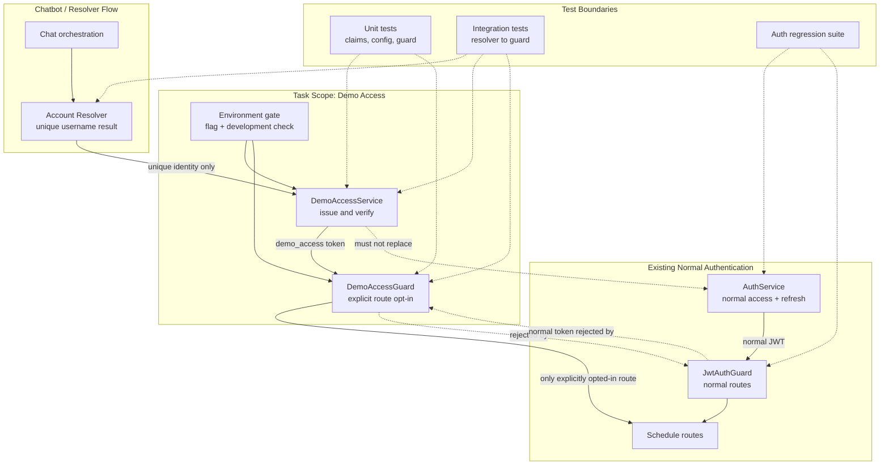

# Architectural Context

## Component Diagram

## Components Involved

- **Chat orchestration**: Requests account resolution but does not mint credentials or decide ambiguous matches.
- **Account Resolver**: Supplies a unique, credential-free account identity; unknown and ambiguous results cannot issue a token.
- **DemoAccessService**: Owns the isolated `demo_access` token contract, dedicated signing configuration, expiry, and verification.
- **DemoAccessGuard**: Verifies only demo tokens and is applied only to explicitly opted-in routes.
- **Environment gate**: Enforces `CHATBOT_DEMO_ACCESS_ENABLED` and the development-only boundary.
- **AuthService / JwtAuthGuard**: Existing normal authentication path; remains authoritative for schedule and normal session routes.
- **Schedule routes**: Downstream consumers. No route becomes demo-enabled implicitly in this task.

## Integration Points

- **Resolver-to-service interface**: The service accepts only a successful unique resolver result and never receives a password or raw credential.
- **Bearer token boundary**: `DemoAccessGuard` reads the bearer token, verifies the dedicated secret plus exact type, issuer, audience, role, demo marker, subject, and expiry.
- **Normal JWT boundary**: `JwtAuthGuard` must reject demo tokens; normal routes continue using normal access JWTs.
- **Configuration boundary**: The feature flag and `NODE_ENV` are evaluated by both issuance and verification paths.
- **Data store**: No new store or remote integration. Existing local JSON-backed account resolver data remains upstream context only.

## Test Boundaries

- **Unit tests**: Use real claim validation logic with test-only secrets and mocked resolver/config inputs. Cover positive claims and every rejection condition.
- **Integration tests**: Exercise unique/unknown/ambiguous resolver outcomes through service issuance and guard verification.
- **Route/regression tests**: Verify demo tokens cannot access normal JWT routes and existing normal login/refresh/logout behavior is unchanged.
- **E2E tests**: No new public endpoint is introduced by this task; add route-level E2E coverage only when a later task explicitly opts a route into the demo guard.

## Downstream Impacts

- Future chatbot account-access routes must explicitly select `DemoAccessGuard` and must not reuse normal JWT guards for demo sessions.
- Future implementation of GYM0008 must expose a stable unique/unknown/ambiguous resolver result without leaking credentials.
- Production deployment cannot enable this prototype capability until a production-grade account recovery and security review is completed.
