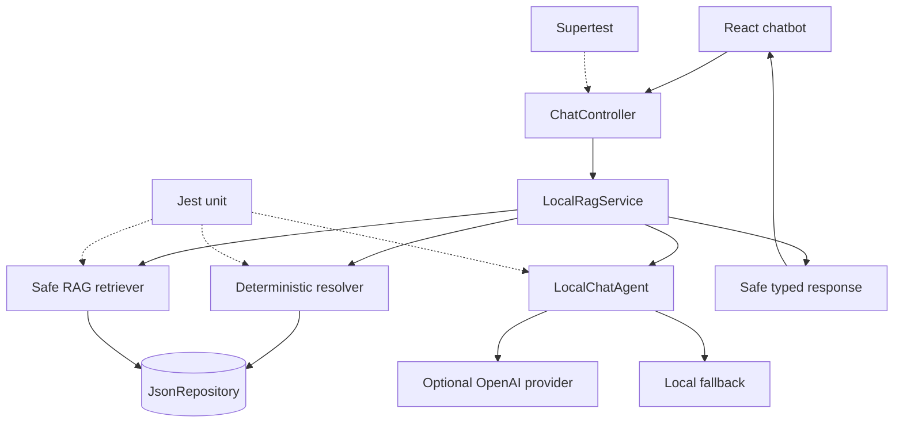

# Technical Implementation Plan — GYM0010

## Scope

Refactor the NestJS chatbot into an explicit safe orchestration flow: normalize request, classify intent, resolve accounts deterministically, retrieve bounded credential-free context, invoke optional provider wording, normalize failures to a deterministic fallback, and return a stable safe response.

## Files/modules

- `apps/api/src/chat/local-rag.service.ts`: resolver -> retrieval -> agent orchestration and safe metadata.
- `apps/api/src/chat/local-rag.retriever.ts`: credential-free account/schedule projections and bounded context.
- `apps/api/src/chat/local-chat.agent.ts`: provider seam, grounded generation, and fallback mapping.
- `apps/api/src/chat/` typed intents, resolution, response, provider-error mapping, and tests.
- `apps/api/test/chat.spec.ts`: update existing password-exposure expectations and add safety/failure coverage.

## Sequence

1. Confirm GYM0008 resolver contract and define typed intent/resolution/response/provider types.
2. Remove passwords/hashes/tokens from retriever documents and build bounded safe context.
3. Refactor `LocalRagService` to coordinate deterministic resolution before retrieval and AI.
4. Add provider seam and map 401/429/network/timeout/missing-key/malformed failures to DEC-010 fallback.
5. Preserve `answer`/`sources`, add safe optional metadata, and keep token issuance in GYM0009.
6. Add unit/API tests for redaction, account/day grounding, ambiguity, prompt injection, provider failures, and frontend compatibility.

## Test inventory

## Response contract

```ts
type ChatResponse = {
  answer: string;
  sources: ChatSource[];
  source: 'openai' | 'local';
  mode: 'answer' | 'fallback' | 'error';
  intent: 'schedule_lookup' | 'account_lookup' | 'access_request' | 'unsupported';
  accountUsername?: string;
  accessIssued: boolean;
  demoOnly: boolean;
};
```

The existing `answer` and `sources` fields remain compatible. Passwords, hashes, refresh/access tokens, provider secrets, raw prompts, and provider error bodies are forbidden from context, sources, responses, and logs.

## Architectural context



## Acceptance criteria

- Known account/schedule questions resolve deterministically before AI.
- Agent context and sources contain only bounded safe fields.
- Unknown/ambiguous/unsupported/no-match inputs cannot authorize access or invent facts.
- OpenAI 401, 429, network, timeout, missing-key, and malformed responses use deterministic local fallback.
- No credentials, hashes, raw tokens, prompts, secrets, or provider error bodies appear in context, output, or logs.
- Account-specific schedule questions retrieve the correct user/day/exercise context.
- `/api/v1/chat` and `/api/v1/chat/public` preserve request compatibility and return the typed safe response.
- Existing normal JWT and schedule behavior remains unchanged; this service does not issue normal tokens.
- API tests cover provider success/failure, redaction, resolver outcomes, fallback, prompt injection, and schedule regression.

## Pipeline requirements

| Gate | Requirement | Expected outcome |
|------|-------------|------------------|
| Lint/typecheck | Existing API scripts | Zero violations |
| Unit | Resolver, projection, intent, agent, fallback, redaction | 100% pass and coverage floors |
| Integration | Supertest with temporary JSON and provider stub | All success/failure/edge boundaries pass |
| Build | Existing API build | Successful build |
| Regression | Authenticated chat/schedule and frontend compatibility | Existing behavior preserved |

## Risks and dependencies

- High risk: current retriever includes plaintext passwords; remove before model/provider use.
- High risk: model account selection; keep resolver authoritative and test ambiguity/prompt injection.
- Medium risk: provider failure; normalize all provider classes to DEC-010 fallback.
- Medium risk: frontend contract; preserve `answer`/`sources` and add optional metadata.
- Blocking dependencies: GYM0008 resolver, GYM0009 demo-access boundary, existing JsonRepository.
- Dependents: GYM0011 frontend and GYM0012 quality/regression tests.

## Implementation strategy

### Phase 1 — Foundation

Confirm resolver/provider seams and define safe transport types/test helpers.

### Phase 2 — Core orchestration

Remove credential projections, coordinate deterministic retrieval, implement provider failure fallback, and preserve response compatibility.

### Phase 3 — Integration and handoff

Add API safety/regression tests, verify GYM0011 compatibility, and run lint/typecheck/build/unit/integration gates.

## Configuration and dev hints

- OpenAI key/model remain server-side environment variables; tests never use live keys.
- `CHATBOT_DEMO_ACCESS_ENABLED` belongs to the access boundary, not model instructions.
- Keep retrieval/fallback pure and bounded for unit tests.
- Use recursive redaction assertions and safe logging assertions.
- Do not add a database, event bus, vector store, or new service.
