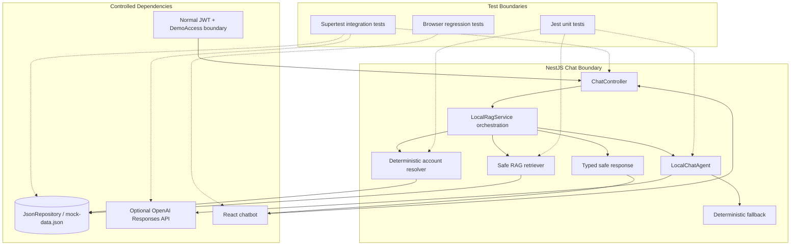

# Architectural Context — GYM0010

## Component Diagram

## Components Involved

- **ChatController**: Validates message input and retains `/api/v1` endpoint behavior.
- **LocalRagService**: Coordinates deterministic intent/resolution, retrieval, agent, fallback, and response metadata.
- **Account resolver**: Produces zero/one/multiple match outcomes before AI.
- **Safe RAG retriever**: Builds bounded credential-free documents from JSON data.
- **LocalChatAgent**: Generates grounded wording from safe documents or invokes deterministic fallback.
- **Typed response mapper**: Preserves `answer`/`sources` and adds safe metadata.

## Integration Points

- `POST /api/v1/chat` and `/api/v1/chat/public`.
- `JsonRepository` as the authoritative local source for users/schedules.
- Optional server-side OpenAI client, always behind a provider seam.
- Normal JWT and separate demo-access boundaries remain outside agent authority.
- React UI consumes safe response fields.

## Test Boundaries

- **Unit**: Mock repository, provider, clock, resolver; test intent, projection, redaction, fallback, and response mapping.
- **Integration**: Use NestJS controller/service wiring, temporary JSON fixtures, provider stubs, and auth context.
- **E2E**: Exercise chat via the UI and preserve login/schedule regression; never use live provider credentials.

## Downstream Impacts

- GYM0008 supplies deterministic resolution behavior.
- GYM0009 supplies demo-access issuance/guard metadata; this task must not duplicate it.
- GYM0011 consumes optional response metadata and fallback state.
- GYM0012 validates redaction, provider failure, prompt injection, and normal auth regressions.
