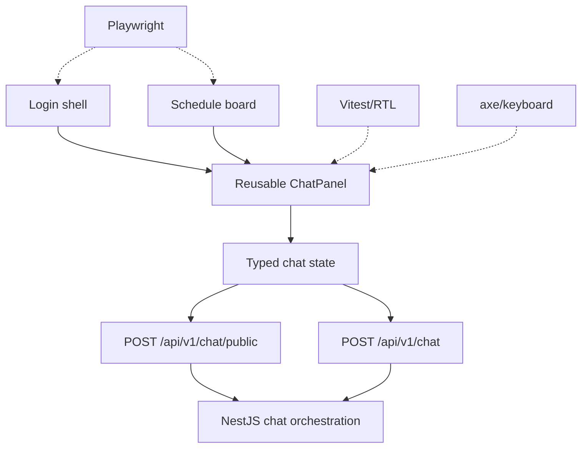

# Technical Implementation Plan — GYM0011

## Scope

Extend the existing React chatbot to present demo-access results and safe failure states clearly, accessibly, and without changing normal login, schedule, or exercise behavior.

## Files/modules

- `apps/web/src/main.tsx`: ChatPanel state, typed response mapping, accordion control, metadata/status rendering.
- `apps/web/src/styles.css`: lower-left panel, login-width alignment, warning/fallback variants, focus, and responsive behavior.
- Existing API client calls: preserve `answer`; consume optional `source`, `mode`, `intent`, `accountUsername`, `accessIssued`, and `demoOnly` metadata.
- Component/accessibility tests and selected browser journeys.

## Sequence

1. Confirm GYM0010 response compatibility and existing Vitest/RTL/browser tooling.
2. Extend response/message state while retaining the required `answer` compatibility field.
3. Refactor ChatPanel to use real accordion buttons with `aria-expanded`, `aria-controls`, and visible `+`/`−` controls.
4. Render success, demo warning, account metadata, fallback, rejection, disabled, and safe error states.
5. Add polite live-region/status and alert semantics, responsive styling, component tests, and selected browser journeys.
6. Run lint, typecheck, build, component tests, accessibility checks, and available E2E gates.

## Test inventory

## Response model

```ts
type ChatResponse = {
  answer: string;
  source?: 'openai' | 'local';
  mode?: 'answer' | 'fallback' | 'demo_access' | 'error';
  intent?: string;
  accountUsername?: string;
  accessIssued?: boolean;
  demoOnly?: boolean;
};
```

The UI whitelists these fields, never renders raw token/password fields, and does not persist credentials or tokens in browser storage.

## Architectural context



## Acceptance criteria

- Public and authenticated chat render safe success responses.
- Demo access displays: “Demo access only — local prototype; do not use real accounts.”
- Unknown, ambiguous, malformed, disabled, fallback, and API-error states are understandable and credential-free.
- Optional unknown response fields are ignored; no password, hash, raw token, provider key, or full prompt appears.
- Accordion controls are keyboard-operable with correct `aria-expanded`/`aria-controls`; statuses and errors are announced.
- Existing login, schedule navigation, and seven-day board behavior remain functional.

## Pipeline and test requirements

| Gate | Coverage |
|------|----------|
| Component tests | All response states, response whitelisting, warning, loading, and accordion behavior |
| Accessibility | Keyboard, focus, labels, live region, alert, and axe checks where available |
| Browser journeys | Public success/rejection, fallback, authenticated chat, and login/schedule regression |
| Quality | Existing lint, typecheck, build, and test scripts; no unapproved dependency additions |

## Risks and dependencies

- GYM0010 must provide optional safe response metadata; `answer` remains the compatibility fallback.
- Existing API and GYM0004 schedule behavior must remain unchanged.
- GYM0012 consumes the resulting states and selectors for regression testing.
- Playwright execution depends on existing or approved shared tooling.
- Security risk is mitigated through field whitelisting, exact demo wording, and no browser credential/token storage.

## Implementation strategy

### Phase 1 — Foundation

Confirm contracts/tooling and define typed response/message state.

### Phase 2 — Core UI

Implement accordion controls, safe metadata rendering, warnings, fallback/rejection/error states, and accessibility semantics.

### Phase 3 — Integration and polish

Add tests, responsive styling, available browser journeys, and quality-gate evidence.

Parallel work includes component tests, accessibility assertions, and CSS refinements using mocked response fixtures.

## Configuration and dev hints

- No frontend API key or environment secret.
- Use existing API base URL and fetch calls.
- Use semantic buttons and roles; avoid document-level heading click handlers.
- Treat API fields as untrusted and whitelist safe metadata.
- Avoid fixed browser sleeps; use condition-based waits.
