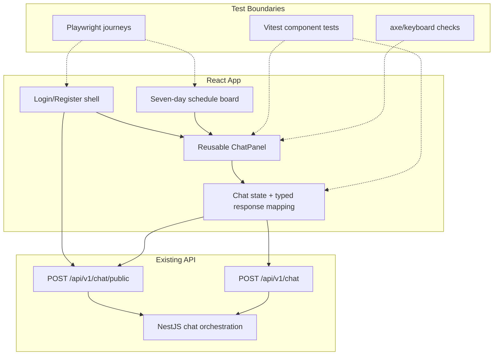

# Architectural Context — GYM0011

## Component Diagram

## Components Involved

- **ChatPanel**: Reusable collapsible UI for public and authenticated chatbot flows.
- **Chat state/response mapper**: Owns loading, success, fallback, rejection, and safe metadata presentation.
- **Login shell**: Hosts the public chatbot and existing authentication controls.
- **Schedule board**: Hosts authenticated chatbot without changing schedule state.
- **NestJS chat API**: Existing backend boundary consumed by the UI.

## Integration Points

- `POST /api/v1/chat/public`: public chat before login.
- `POST /api/v1/chat`: authenticated schedule chat.
- Typed optional response metadata from GYM0010: `source`, `mode`, `intent`, `accountUsername`, `accessIssued`, and `demoOnly`.
- No direct frontend access to JSON, model provider, passwords, hashes, or raw tokens.

## Test Boundaries

- **Unit/component**: Mock `fetch`, render real React state, and assert accessible roles, labels, metadata, and redaction.
- **Integration/browser**: Use local API stubs or local API process to validate public/authenticated response handling.
- **E2E**: Validate public chatbot success/rejection and authenticated chatbot plus schedule regression.
- **Accessibility**: Verify keyboard operation, focus, `aria-expanded`, live status, and alert semantics.

## Downstream Impacts

- GYM0010 must preserve the `answer` compatibility field and expose optional safe metadata.
- GYM0012 must test the resulting UI states and accessibility contract.
- Existing login and schedule behavior remain unchanged.
