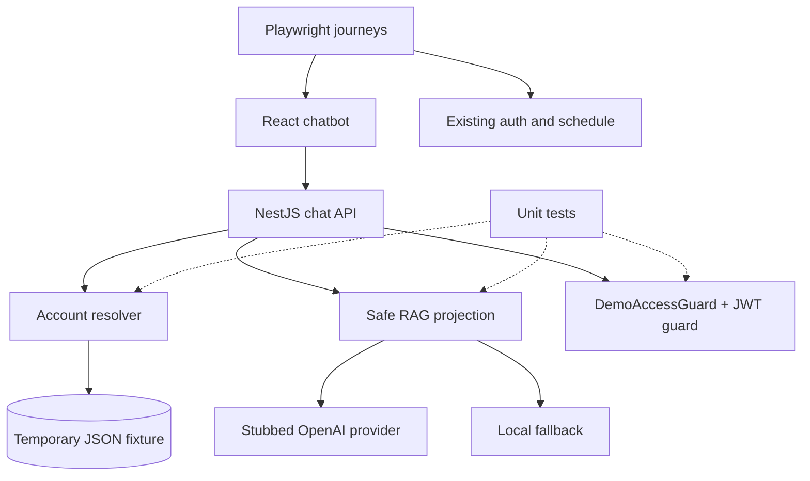

# Technical Implementation Plan — GYM0012

## Scope

GYM0012 provides automated quality and regression coverage for chatbot account access. It protects deterministic account selection, credential-free RAG, isolated `demo_access` authorization, local-only enablement, provider fallback, and normal login/schedule behavior.

## Files/modules

- [Chatbot test strategy](../../../explore/explore-chatbot-account-access/test-strategy.md) defines Jest, Vitest, Supertest, Playwright, axe, coverage, and critical journeys.
- [Existing scheduler test strategy](../../../explore/explore-gym-scheduler/test-strategy.md) establishes the testing pyramid and browser expectations.
- [ADR-004](../../../explore/decisions/gym-scheduler-adr-004-secure-session.md) governs normal JWT/session behavior.
- [Chatbot decision log](../../../explore/hlds/chatbot-account-access-decision-log.md) defines DEC-008 through DEC-012.
- GYM0003, GYM0004, and GYM0005 provide existing authentication, schedule, and exercise regression behavior.
- GYM0008–GYM0011 provide the feature seams this task validates.

## Sequence

1. Confirm scripts and fixtures; prepare resolver, token, guard, and provider-stub test utilities.
2. Add backend unit/API tests alongside GYM0008–GYM0010 and frontend component/accessibility tests alongside GYM0011.
3. Add Playwright journeys for successful demo access, safe rejection, and existing login-to-schedule regression.
4. Run lint, typecheck, unit, integration, build, and selected E2E gates; record evidence.

## Test inventory

## Technical approach

- Jest for backend, Vitest + React Testing Library for frontend, Supertest for API integration, Playwright for E2E, and axe where available.
- Stub the OpenAI boundary for success, 401, 429, network, missing-key, and malformed-response cases; never use a live key.
- Use builders for unit tests and temporary JSON fixture copies for integration tests; never mutate checked-in JSON.
- Assert absence of `password`, `passwordHash`, raw token, provider secret, and full prompt fields in contexts, responses, and captured logs.
- Assert `demo_access` works only with its dedicated guard and is rejected by normal schedule authorization.

## Architectural context

## Acceptance and pipeline gates

- Known unique username resolves safely; unknown, malformed, and duplicate usernames cannot authorize access.
- Provider failures use the DEC-010 envelope; no credentials, hashes, tokens, secrets, or full prompts leak.
- Disabled/non-development demo access issues no token.
- Invalid, expired, wrong-audience, wrong-issuer, and wrong-type tokens are rejected.
- Prompt injection cannot select an account or authorize access.
- Every chatbot boundary has success, failure, and edge coverage.
- Three critical Playwright journeys and accessibility checks pass.
- Changed business logic reaches 90% line and 85% branch coverage.
- Lint/typecheck, unit, integration, build, and selected E2E gates pass.

## Risks and dependencies

- Mandatory negative security cases prevent omitted boundary coverage.
- Provider stubs model every failure class; fixture copies prevent order dependence.
- Existing GYM0003/GYM0004 journeys prevent auth/schedule regressions.
- Blocking feature seams: GYM0008, GYM0009, GYM0010, GYM0011.
- Related baselines: GYM0003, GYM0004, GYM0005.

## Configuration and dev hints

- Test `CHATBOT_DEMO_ACCESS_ENABLED=false` by default and development-enabled mode explicitly.
- Never read or write production `.env` files in tests.
- Use stable accessible selectors and condition-based waits; avoid fixed browser sleeps.
- Do not add dependencies without approval; verify existing package scripts first.
