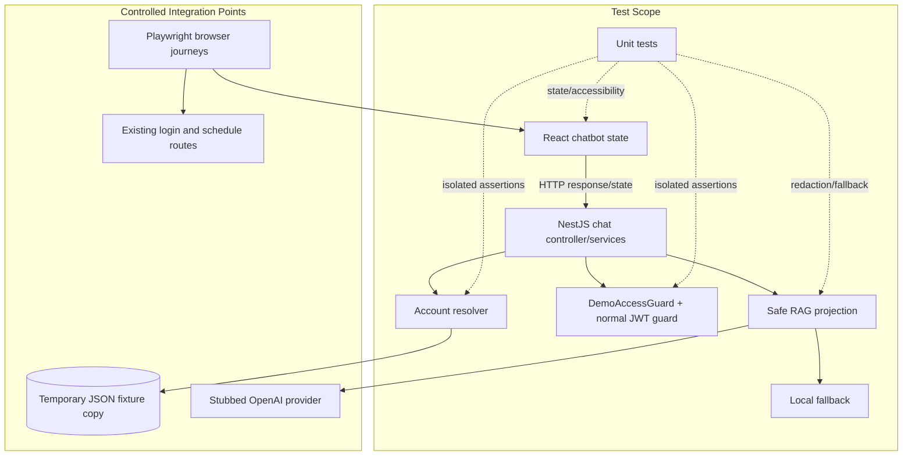

# Architectural Context — GYM0012

## Component Diagram

## Components Involved

- **React chatbot**: Renders success, rejection, fallback, warning, loading, and accessible status states.
- **NestJS chat orchestration**: Receives requests and coordinates resolver, safe RAG, provider stub, fallback, and response mapping.
- **Account resolver**: Deterministically handles unique, unknown, malformed, and duplicate usernames.
- **DemoAccessGuard and normal JWT guard**: Prove token separation and authorization boundaries.
- **RAG projection/fallback**: Prove credentials are excluded and provider failures remain safe.
- **JSON repository fixture**: Supplies isolated synthetic records for integration tests.
- **Existing login/schedule flow**: Provides regression coverage for normal authentication and ownership.

## Integration Points

- **Chat HTTP API**: Supertest exercises request validation and response envelopes.
- **JSON repository**: Tests use temporary copies; no production fixture mutation.
- **OpenAI provider boundary**: Tests use a stub with success and failure modes.
- **Authorization boundary**: Tests compare dedicated demo guard behavior with normal JWT guard rejection.
- **Browser/API integration**: Playwright validates only critical journeys with local synthetic data.

## Test Boundaries

- **Unit tests**: Mock filesystem, provider, clock, and unrelated services; test pure business rules.
- **Integration tests**: Use NestJS HTTP modules, temporary JSON fixtures, real mapping/guard wiring, and provider stubs.
- **E2E tests**: Use local API and frontend processes; cover successful demo access, safe rejection, and existing login-to-schedule regression.
- **Accessibility tests**: Run against rendered chatbot states with axe and keyboard/focus assertions.

## Downstream Impacts

- Implementation tasks GYM0008–GYM0011 must expose deterministic seams that GYM0012 can test.
- Existing authentication and schedule behavior must remain unchanged and pass regression journeys.
- No remote database, event bus, production provider, or deployment environment is introduced.
